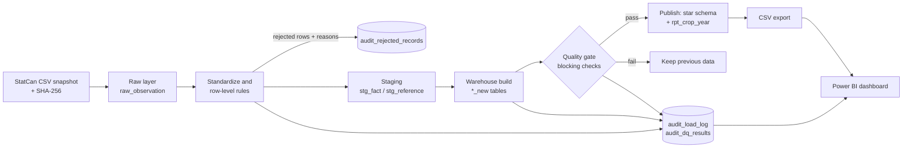

# AgriPulse Canada

An auditable data pipeline and Power BI dashboard for exploring Canadian field-crop production.

> **Independent portfolio project.** This is not an official Government of Canada or
> Agriculture and Agri-Food Canada (AAFC) system. It uses public open data and does not speak for any
> government organization.

## What it does

1. **Acquires** Statistics Canada table 32-10-0359-01 (area, yield, production, farm price and
   farm value of principal field crops) as a dated, checksummed snapshot.
2. **Cleans and validates** it: rejects unusable rows with a recorded reason, standardizes crop names,
   and runs reconciliation checks before anything is published.
3. **Loads a star schema** (dimensions and a fact table) and a reporting table, published only if the
   blocking checks pass.
4. **Reports** through a Power BI dashboard, including a data-quality and pipeline-monitoring page
   backed by an audit trail of every run.

## Architecture



## Quick start

```bash
pip install -r requirements.txt
pytest -q                                              # unit and integration tests
python scripts/download_data.py                        # saves data/raw/real/32100359_<date>.csv
python -m src.profile --csv data/raw/real/<file>.csv   # check measures, crops, geographies first
python -m src.pipeline --csv data/raw/real/<file>.csv --label real
```

Outputs land in `reports/powerbi/` (dimensions, `rpt_crop_year.csv`, and the `audit_*` tables).

### Simulated failure tests

To demonstrate monitoring, create a deliberately corrupted copy and run it. These runs use
`--label simulated`, are **never published**, and appear on the dashboard as simulated tests, not as
defects in the official data.

```bash
python scripts/make_defect_copy.py --input data/raw/real/<file>.csv --mode rows     # row-level defects
python -m src.pipeline --csv data/raw/simulated/simulated_rows_defects.csv --label simulated
python scripts/make_defect_copy.py --input data/raw/real/<file>.csv --mode schema   # breaks the schema
python -m src.pipeline --csv data/raw/simulated/simulated_schema_defects.csv --label simulated
```

## Data quality and reconciliation

Full detail is in [docs/DQ_RULES.md](docs/DQ_RULES.md).

| Group | Checks |
|---|---|
| Row level (rows are rejected with a reason) | invalid year, missing dimension, unmapped measure, missing value, non-numeric value, negative value, duplicate key |
| Standardization (rows kept and flagged) | inconsistent crop spellings, crop names not in the catalog, StatCan "use with caution" flag, implausible yields |
| Dataset level | schema contract, row conservation, completeness of each series, production = area x yield, hectares vs acres, provinces vs Canada total, release-to-release revisions, freshness |
| Reconciliation (blocking) | staging equals warehouse (counts and sums); published report table equals warehouse |

Blocking checks stop publishing and keep the previous data in place.

## Results

_Fill in after the first real run (numbers come from `reports/powerbi/audit_load_log.csv`):_

| Item | Value |
|---|---|
| Source file / SHA-256 | |
| Rows read / loaded / rejected / reference-only | |
| Rows flagged | |
| Checks passed / warned / failed | |
| Latest reference year | |

## Project structure

```
src/        pipeline code (ingest, standardize, quality, warehouse, export, profile)
scripts/    download_data.py, make_defect_copy.py, make_demo_data.py
sql/        schema for raw and audit tables
config/     crop_catalog.csv (created on first run), crop_aliases.csv (optional)
docs/       DQ_RULES.md, DATA_DICTIONARY.md, POWERBI_GUIDE.md
powerbi/    the .pbix file and dashboard screenshots
tests/      pytest suite (runs on synthetic data in CI)
```

## Data sources and attribution

- Statistics Canada, Table 32-10-0359-01, *Estimated areas, yield, production, average farm price and
  total farm value of principal field crops, in metric and imperial units*.
- Contains information licensed under the
  [Open Government Licence – Canada](https://open.canada.ca/en/open-government-licence-canada).

The tests use **synthetic** data shaped like the real table. Nothing synthetic appears in the dashboard.

## Limitations

- Values for the most recent year can be preliminary or model-based and are revised in later releases.
- Imperial-unit rows are kept as reference only, and used to cross-check areas.
- Suppressed provincial values can make provinces add up to less than the Canada total.
- The dashboard describes patterns; it does not claim that weather caused any production change.

## Roadmap

- **Phase 2:** climate context from the Canadian Drought Monitor (monthly drought classes by province).
- **Phase 3:** supply and disposition tables, and a scheduled refresh with GitHub Actions.
